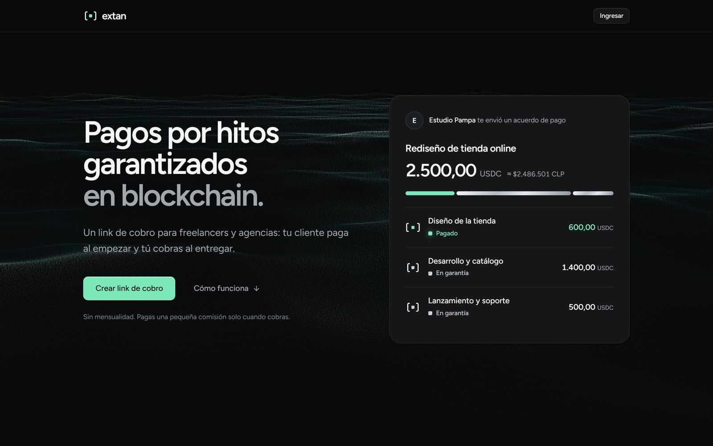
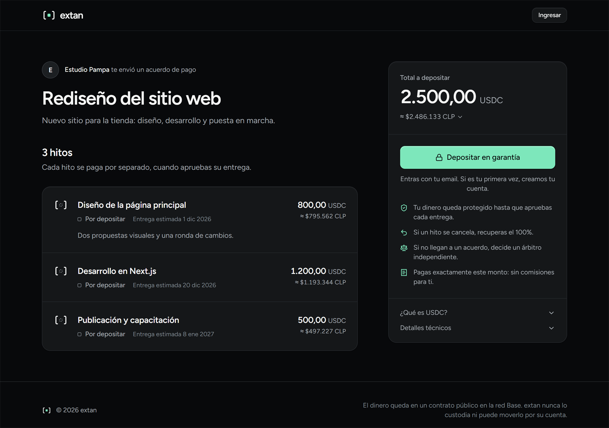
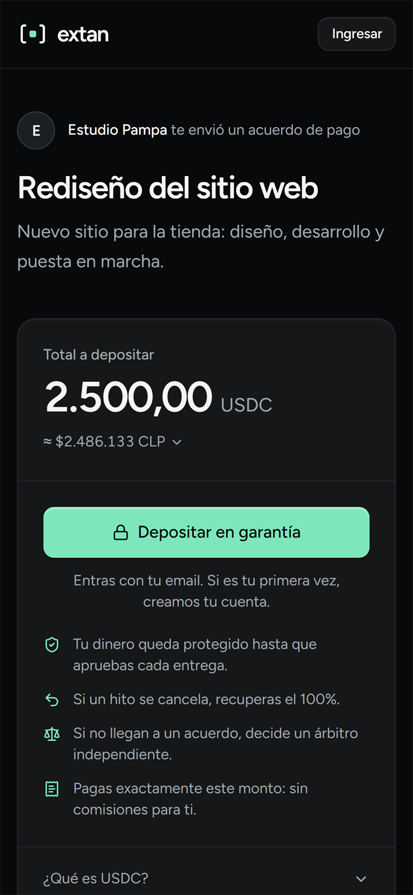
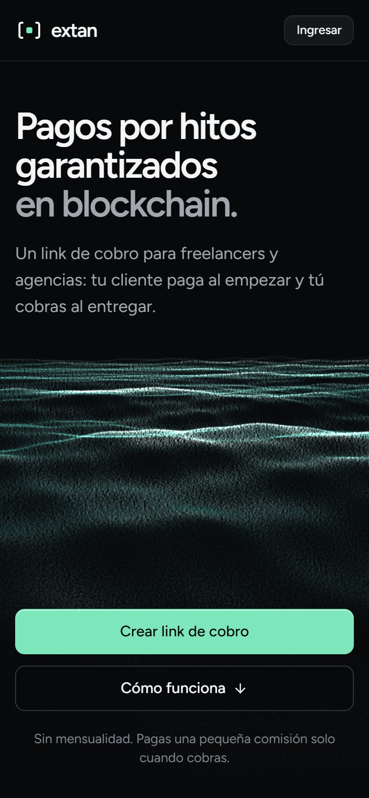
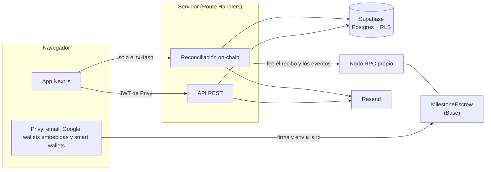

# extan

**Pagos por hitos garantizados en blockchain.** Un link de cobro para freelancers y agencias: el cliente paga al
empezar y el proveedor cobra al entregar. El depósito, en USDC sobre Base, queda en un smart contract público y nunca
en manos de la plataforma; cada hito se libera cuando se aprueba su entrega.

[English](README.md) · [Contrato verificado](https://base-sepolia.blockscout.com/address/0xb7BABf0046fb8Bb2E3Ea0e6B75abdDEb31B9F863?tab=contract) · [Informe de análisis estático](docs/analisis-estatico.md) · Demo pública: pronto

<p align="center">
  
</p>

| Checkout (escritorio) | Checkout (teléfono) | Portada (teléfono) |
| --- | --- | --- |
|  |  |  |

## Por qué

En Latinoamérica, el trabajo freelance y por proyecto funciona a base de confianza: el cliente no quiere pagar por
adelantado, el proveedor no quiere trabajar sin garantía y los pagos entre países son lentos y caros. Los servicios
de escrow tradicionales guardan ellos mismos el dinero y cobran en consecuencia.

extan saca al intermediario de la custodia. El depósito del cliente queda en un smart contract que solo permite tres
resultados: pagarle al proveedor, devolverle al cliente o repartir según decida un árbitro independiente. Nadie, ni
siquiera extan, puede quedarse con los fondos. Y el cliente no necesita saber nada de esto: entra con su email y el
gas va patrocinado.

## Estado

- **Testnet.** El contrato está desplegado y verificado en Base Sepolia. El flujo completo (depósito, entrega,
  liberación, reembolso, disputa y resolución del árbitro) está probado de punta a punta con wallets reales.
- **Demo pública:** en preparación; el plan paso a paso está en [docs/demo-portafolio.md](docs/demo-portafolio.md).
- **Aún no es producción.** Mainnet exige una auditoría externa, una entidad legal y un on-ramp desde moneda local
  ([roadmap](docs/roadmap.md)).

## Funcionalidades

- **Links de cobro** con hasta 20 hitos, cada uno con su monto, detalle y fecha. El cliente recibe una invitación por
  email o el link por WhatsApp.
- **Checkout estilo Stripe:** montos en USDC con su equivalente en moneda local y un depósito guiado que espera la
  llegada de los fondos si falta saldo.
- **Sin saber de cripto:** ingreso con email o Google y wallet embebida, smart wallets ERC-4337 con gas patrocinado,
  o cualquier wallet externa (MetaMask, Coinbase Wallet, WalletConnect).
- **Acciones por hito:** entregar, liberar, reembolsar o disputar. La disputa reúne la versión de ambas partes.
- **Panel de arbitraje:** arma la resolución como lote de Safe Transaction Builder, para que el árbitro firme desde
  un multisig.
- **Emails** en cada evento, idempotentes por log on-chain.

## Arquitectura



El dinero solo se mueve entre las wallets y el contrato. La base de datos guarda lo que el contrato no necesita
(títulos, emails, entregas, evidencias) y un reflejo del estado on-chain para leerlo rápido.

## Decisiones técnicas

- **No-custodio por diseño.** Pausar el contrato solo frena depósitos nuevos; liberar, reembolsar, disputar y
  resolver funcionan siempre. El árbitro puede repartir un hito, pero nunca recibir el principal. La comisión y el
  árbitro quedan fijos en cada escrow: cambiar la configuración no afecta acuerdos ya fondeados.
- **El backend no confía en el frontend.** Después de cada transacción, el navegador solo envía el `txHash`. El
  servidor lee el recibo desde su propio RPC, decodifica los eventos del contrato y valida el id del acuerdo, el
  proveedor, el token y el monto de cada hito antes de escribir.
- **Reconciliación idempotente.** `(tx_hash, log_index)` es único: los reintentos y los syncs simultáneos no duplican
  registros ni correos. Un sync que se cortó al cerrar la pestaña se retoma en la siguiente visita.
- **Defensa en profundidad en la base.** Solo el backend escribe; los usuarios leen solo sus acuerdos por RLS; el
  checkout público pasa por una función que no expone emails ni entregas; la actividad y las evidencias son
  append-only.
- **Depósitos sin gas.** `approve` y el depósito viajan en una sola UserOperation ERC-4337 patrocinada; las wallets
  externas firman un `permit` EIP-2612 y depositan en una sola transacción.
- **Protección contra abuso sin infraestructura extra.** Límites por ventana fija guardados en Postgres (por cuenta,
  y por IP con hash en la ruta pública), que responden `429` con `Retry-After`.
- **Operación segura.** Los deploys firman con keystore cifrado o Ledger, nunca con una llave en `.env`. Owner y
  árbitro son Safes multisig y el traspaso de owner es en dos pasos.

El detalle está en [docs/arquitectura.md](docs/arquitectura.md).

## Tecnologías

| Capa | Tecnología |
| --- | --- |
| Smart contract | Solidity 0.8.28, Foundry, OpenZeppelin 5, Base (L2 de Ethereum), USDC |
| Frontend | Next.js 15 (App Router), React 19, TypeScript, Tailwind CSS 4, shadcn/ui, TanStack Query |
| Web3 | Privy (auth, wallets embebidas y smart wallets), wagmi, viem, ERC-4337, EIP-2612 |
| Backend | Route Handlers de Next.js, Zod, Supabase (Postgres 17, RLS), Resend |
| Herramientas | pnpm workspaces, Turborepo, ESLint, Prettier, Vitest, pgTAP, Slither |

## Calidad

| Área | Verificaciones |
| --- | --- |
| Contrato | 55 tests de Foundry (unitarios y fuzzing), 100 % de cobertura de líneas y ramas, Slither sin hallazgos, `forge lint` |
| Base de datos | 47 tests pgTAP: constraints, RLS, funciones del backend y límites |
| Lógica compartida | 27 tests de Vitest: paridad del reparto con el contrato, montos, ids de referencia, esquemas y estados |
| App web | TypeScript estricto, ESLint, Prettier y build de producción |

## Estructura del repositorio

```
apps/web/            App Next.js: páginas, rutas de la API, componentes y lógica solo de servidor
packages/contracts/  Proyecto Foundry: MilestoneEscrow, tests y script de deploy
packages/shared/     ABI tipado, redes, esquemas Zod, utilidades de montos y tipos de la base
supabase/            Migraciones y tests pgTAP
docs/                Guías, arquitectura, roadmap e informes
```

## Cómo correrlo

Requisitos: Node.js 22+, pnpm 10+, [Foundry](https://getfoundry.sh) y Docker con la CLI de Supabase.

```bash
git clone --recurse-submodules https://github.com/john-Mcan/escrow.git
cd escrow
pnpm install
cp .env.example .env

pnpm db:start                                  # Supabase local
pnpm --filter @escrow/contracts anvil          # terminal 1: red local
pnpm --filter @escrow/contracts deploy:local   # terminal 2: MockUSDC + MilestoneEscrow
pnpm --filter @escrow/web dev                  # http://localhost:3000
```

Las verificaciones: `pnpm format:check`, `pnpm lint`, `pnpm typecheck`, `pnpm test` y `supabase test db`. La guía
completa (Base Sepolia, deploys, configuración de Privy y rutas de la API) está en
[docs/desarrollo.md](docs/desarrollo.md).

## Documentación

- [Arquitectura](docs/arquitectura.md): contrato, pagos, consistencia on-chain/off-chain y base de datos.
- [Desarrollo](docs/desarrollo.md): puesta en marcha, verificaciones, deploys y rutas.
- [Análisis estático](docs/analisis-estatico.md): informe de Slither del contrato.
- [Roadmap](docs/roadmap.md): de testnet a mainnet.
- [Marca](docs/marca.md): nombre, color, tipografía y voz.

## Licencia

Copyright © 2026 John Moya C. Todos los derechos reservados: el código es público para revisarlo, no para
reutilizarlo. Los smart contracts de [`packages/contracts`](packages/contracts) tienen licencia MIT. Ver
[LICENSE](LICENSE).
