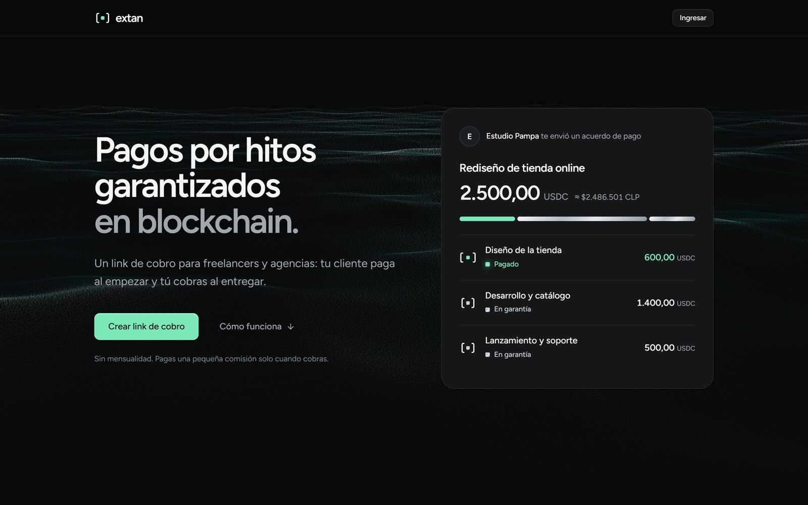
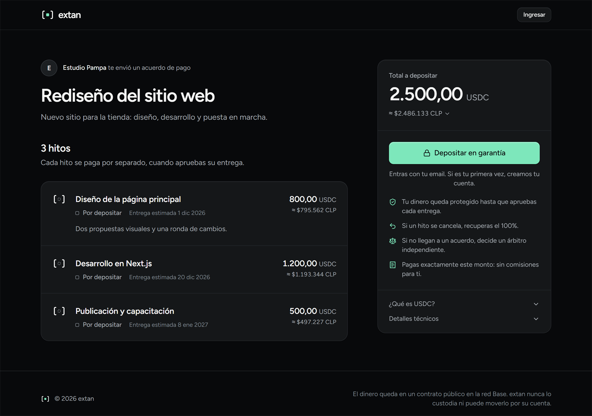
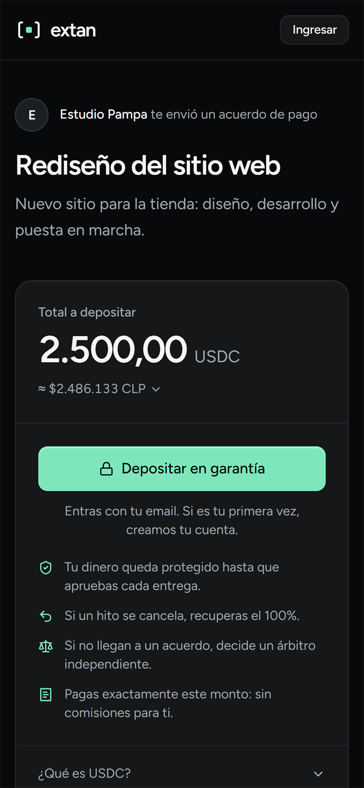
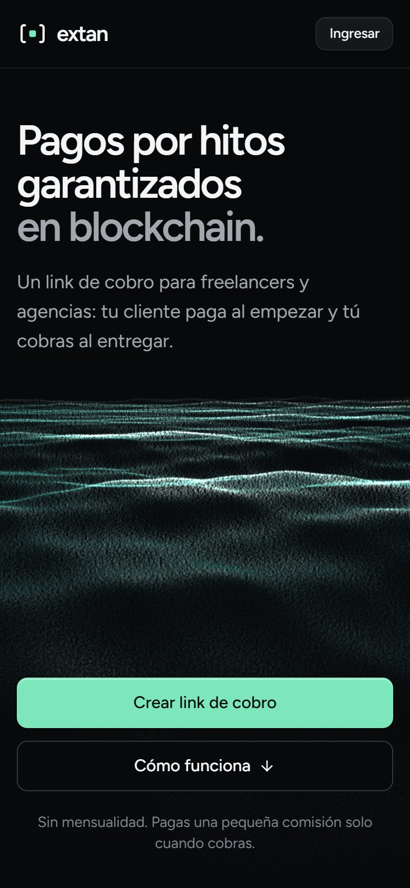
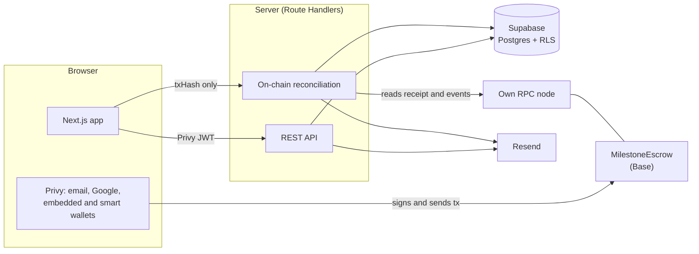

# extan

**Milestone payments, guaranteed on-chain.** A payment link for freelancers and agencies: the client pays up front and
the provider gets paid on delivery. The deposit, in USDC on Base, sits in a public smart contract and never with the
platform; each milestone is released when its delivery is approved.

[Español](README.es.md) · [Verified contract](https://base-sepolia.blockscout.com/address/0xb7BABf0046fb8Bb2E3Ea0e6B75abdDEb31B9F863?tab=contract) · [Static analysis report](docs/analisis-estatico.md) · Live demo: coming soon

<p align="center">
  
</p>

| Checkout (desktop) | Checkout (mobile) | Landing (mobile) |
| --- | --- | --- |
|  |  |  |

## Why

In Latin America, freelance and project work runs on trust: clients don't want to pay up front, providers don't want
to work without a guarantee, and cross-border payments are slow and expensive. Traditional escrow services hold the
money themselves and charge accordingly.

extan removes the middleman from custody. The client's deposit is locked in a smart contract that only allows three
outcomes: pay the provider, refund the client, or split it as decided by an independent arbiter. Nobody, including
extan, can take the funds. And the client doesn't need to know any of this: they sign in with their email, and the
gas is sponsored.

## Status

- **Testnet.** The contract is deployed and verified on Base Sepolia. The full flow (deposit, delivery, release,
  refund, dispute and arbiter resolution) has been tested end to end with real wallets.
- **Public demo:** being deployed; the step-by-step plan is in [docs/demo-portafolio.md](docs/demo-portafolio.md).
- **Not production yet.** Mainnet requires an external audit, a legal entity and a fiat on-ramp
  ([roadmap](docs/roadmap.md)).

## Features

- **Payment links** with up to 20 milestones, each with its own amount, details and due date. The client can be
  invited by email or the link shared over WhatsApp.
- **Stripe-style checkout:** amounts in USDC with their local-currency equivalent, and a guided deposit that waits for
  funds to arrive if the balance is short.
- **No crypto knowledge required:** email or Google sign-in with an embedded wallet, ERC-4337 smart wallets with
  sponsored gas, or any external wallet (MetaMask, Coinbase Wallet, WalletConnect).
- **Per-milestone actions:** deliver, release, refund or dispute. Disputes collect evidence from both parties.
- **Arbitration panel:** builds the resolution as a Safe Transaction Builder batch, so the arbiter signs from a
  multisig.
- **Email notifications** for every event, idempotent per on-chain log.

## Architecture



Money moves only between wallets and the contract. The database stores what the contract doesn't need (titles,
emails, deliverables, evidence) plus a mirror of the on-chain state for fast reads.

## Engineering highlights

- **Non-custodial by construction.** Pausing the contract only blocks new deposits; release, refund, dispute and
  resolution always work. The arbiter can split a milestone but never receive the principal. Fee and arbiter are
  snapshotted per escrow, so configuration changes never affect funded agreements.
- **The backend never trusts the frontend.** After each transaction the browser sends only a `txHash`. The server
  reads the receipt from its own RPC, decodes the contract events and checks the agreement id, payee, token and every
  milestone amount before writing anything.
- **Idempotent reconciliation.** `(tx_hash, log_index)` is unique, so retries and concurrent syncs never duplicate
  records or emails. A sync interrupted by a closed tab resumes on the next visit.
- **Defense in depth in the database.** Only the backend writes; authenticated users read only their own agreements
  through RLS; the public checkout goes through a function that exposes no emails or deliverable links; activity and
  evidence tables are append-only.
- **Gasless deposits.** `approve` and the deposit travel in one sponsored ERC-4337 UserOperation; external wallets use
  an EIP-2612 `permit` and deposit in a single transaction.
- **Abuse protection without extra infrastructure.** Fixed-window rate limits stored in Postgres (per account, and per
  hashed IP on the public endpoint), returning `429` with `Retry-After`.
- **Operational safety.** Deploys sign with an encrypted keystore or a Ledger, never a private key in `.env`. Owner
  and arbiter are Safe multisigs; ownership transfers are two-step.

The full design rationale is in [docs/arquitectura.md](docs/arquitectura.md) (Spanish).

## Tech stack

| Layer | Technology |
| --- | --- |
| Smart contract | Solidity 0.8.28, Foundry, OpenZeppelin 5, Base (Ethereum L2), USDC |
| Frontend | Next.js 15 (App Router), React 19, TypeScript, Tailwind CSS 4, shadcn/ui, TanStack Query |
| Web3 | Privy (auth, embedded and smart wallets), wagmi, viem, ERC-4337, EIP-2612 |
| Backend | Next.js Route Handlers, Zod, Supabase (Postgres 17, RLS), Resend |
| Tooling | pnpm workspaces, Turborepo, ESLint, Prettier, Vitest, pgTAP, Slither |

## Quality

| Area | Checks |
| --- | --- |
| Contract | 55 Foundry tests (unit and fuzz), 100% line and branch coverage, Slither with zero findings, `forge lint` |
| Database | 47 pgTAP tests: constraints, RLS, backend functions and rate limits |
| Shared logic | 27 Vitest tests: fee split parity with the contract, amounts, reference ids, schemas and status rules |
| Web app | Strict TypeScript, ESLint, Prettier, production build |

## Repository structure

```
apps/web/            Next.js app: pages, API routes, components, server-only logic
packages/contracts/  Foundry project: MilestoneEscrow, tests, deploy script
packages/shared/     Typed ABI, chain config, Zod schemas, money utilities, database types
supabase/            Migrations and pgTAP tests
docs/                Guides, architecture, roadmap and reports (Spanish)
```

## Getting started

Requirements: Node.js 22+, pnpm 10+, [Foundry](https://getfoundry.sh), and Docker with the Supabase CLI.

```bash
git clone --recurse-submodules https://github.com/john-Mcan/escrow.git
cd escrow
pnpm install
cp .env.example .env

pnpm db:start                                  # local Supabase
pnpm --filter @escrow/contracts anvil          # terminal 1: local chain
pnpm --filter @escrow/contracts deploy:local   # terminal 2: MockUSDC + MilestoneEscrow
pnpm --filter @escrow/web dev                  # http://localhost:3000
```

Run the checks with `pnpm format:check`, `pnpm lint`, `pnpm typecheck`, `pnpm test` and `supabase test db`. The full
development guide (Base Sepolia setup, deploys, Privy configuration and API routes) is in
[docs/desarrollo.md](docs/desarrollo.md).

## Documentation

All guides are in Spanish.

- [Architecture](docs/arquitectura.md): contract, payments, on-chain/off-chain consistency and database.
- [Development](docs/desarrollo.md): setup, checks, deploys and routes.
- [Static analysis](docs/analisis-estatico.md): Slither report for the contract.
- [Roadmap](docs/roadmap.md): from testnet to mainnet.
- [Brand](docs/marca.md): name, colors, typography and voice.

## License

Copyright © 2026 John Moya C. All rights reserved: the code is public for review, not for reuse. The smart contracts in
[`packages/contracts`](packages/contracts) are MIT-licensed. See [LICENSE](LICENSE).
