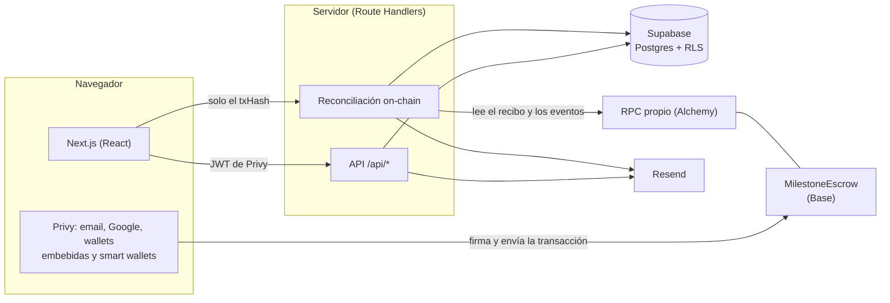

# Arquitectura

Cómo está construido extan y por qué. La guía para correrlo está en [desarrollo.md](desarrollo.md).

## Visión general

El dinero nunca pasa por el servidor: el cliente deposita USDC directo en el contrato desde su wallet, y el contrato
solo permite que los fondos salgan hacia el proveedor, de vuelta al cliente o según el reparto de un árbitro. La base
de datos guarda lo que el contrato no necesita (títulos, emails, entregables, evidencias) y un reflejo del estado
on-chain para mostrarlo rápido.

## Smart contract: `MilestoneEscrow`

| Función | Quién | Efecto |
|---|---|---|
| `createAndFundEscrow` / `…WithPermit` | Cliente (payer) | Crea el escrow y deposita el total (con EIP-2612 en una transacción) |
| `releaseMilestone` | Cliente | Monto neto al proveedor y comisión a `feeRecipient`, en la misma transacción |
| `refundMilestone` | Proveedor (payee) | El 100 % del hito vuelve al cliente, sin comisión |
| `raiseDispute` | Cliente o proveedor | Congela el hito (`Disputed`) |
| `resolveDispute` | Árbitro del escrow | Reparte entre cliente y proveedor (`payerShareBps`); la comisión aplica solo a la porción del proveedor |

Decisiones de diseño:

- **La pausa solo frena depósitos nuevos.** Liberar, reembolsar, disputar y resolver funcionan siempre: la
  plataforma no puede retener fondos.
- **Snapshot por escrow** de la comisión y del árbitro: cambiar la configuración no altera acuerdos ya fondeados.
- **Allowlist de tokens** (USDC) y verificación del monto recibido: protege la contabilidad si el token cobrara
  comisión por transferencia.
- **El árbitro nunca recibe el principal:** solo reparte entre las partes, y ninguna de ellas puede ser el árbitro.
- **Límites:** `maxEscrowAmount` (5.000 USDC por defecto, configurable por el owner) y 20 hitos por escrow.
- **Estado `Resolved`** aparte de `Released` y `Refunded`, para distinguir un reparto arbitral (incluido uno parcial).
- **`referenceId`** (el UUID del acuerdo en Supabase, como `bytes32`) en `EscrowCreated`, para que el backend
  reconcilie sin confiar en el frontend.
- **Owner y árbitro son Safes multisig** en producción; `Ownable2Step` exige que el nuevo owner acepte el traspaso.

Calidad: 55 tests de Foundry (unitarios y fuzzing), 100 % de cobertura y cero hallazgos de Slither
([analisis-estatico.md](analisis-estatico.md)). Desplegado y verificado en Base Sepolia:
[`0xb7BA…F863`](https://base-sepolia.blockscout.com/address/0xb7BABf0046fb8Bb2E3Ea0e6B75abdDEb31B9F863?tab=contract).

## Pagos sin fricción

El cliente no necesita saber qué es una wallet:

- **Ingreso con email o Google** (Privy): se crea una wallet embebida, y con smart wallets activas, una cuenta ERC-4337.
- **Smart wallet:** `approve` y el depósito viajan en una sola UserOperation con gas patrocinado por un paymaster. El
  usuario no necesita ETH.
- **Wallet externa** (MetaMask, Coinbase Wallet…): firma `permit` (EIP-2612) y deposita en una sola transacción; si
  el token no soporta `permit`, cae a `approve` + depósito.
- **Sin saldo:** el checkout muestra la dirección con QR y espera la llegada del USDC.
- Montos en USDC con su equivalente en moneda local (tipo de cambio referencial de Coinbase).

## Consistencia on-chain / off-chain

- El frontend nunca marca nada como pagado: después de cada transacción solo envía el `txHash` a
  `POST /api/escrow/sync`.
- El backend lee el recibo desde **su propio** RPC, decodifica los eventos de `MilestoneEscrow` y valida
  `referenceId`, proveedor, token y el monto de cada hito antes de escribir en Supabase.
- `(tx_hash, log_index)` es único en `escrow_activity_logs`: repetir el sync no duplica registros ni correos (Resend
  recibe además claves de idempotencia).
- Si el navegador se cierra entre la confirmación y el sync, el hash queda guardado y la vista `/pay` reintenta al
  volver.

## Base de datos

- Privy es el proveedor de identidad. **Solo el backend (service role) escribe**, después de verificar el token de
  Privy o la transacción on-chain.
- `authenticated` solo lee los escrows donde participa (creador, o cliente/proveedor por wallet o email verificado).
- `anon` no accede a tablas: el checkout público usa `get_public_checkout(uuid | short_code)`, que no expone emails
  ni enlaces a entregables.
- `escrow_activity_logs` y `disputes_evidence` son **append-only**: sin UPDATE ni DELETE, ni siquiera para el backend.
- 47 tests pgTAP cubren constraints, RLS, funciones del backend y el límite de solicitudes.

## Protección contra abuso

- **Límite de solicitudes** con contadores por ventana fija en Postgres (`consume_rate_limit`), sin servicios extra:
  crear links (10 por hora y 30 por día), entregables y evidencias (20 por hora) por cuenta, y el sync público (60
  por hora) por IP, guardada como HMAC. Al pasarse responde 429 con `Retry-After`.
- **Validación con Zod** compartida entre el formulario y la API (`packages/shared`).
- **Headers de seguridad** (`X-Frame-Options`, `nosniff`, `Referrer-Policy`, `Permissions-Policy`).
- **Errores controlados:** la API responde mensajes en español y nunca expone errores internos.
